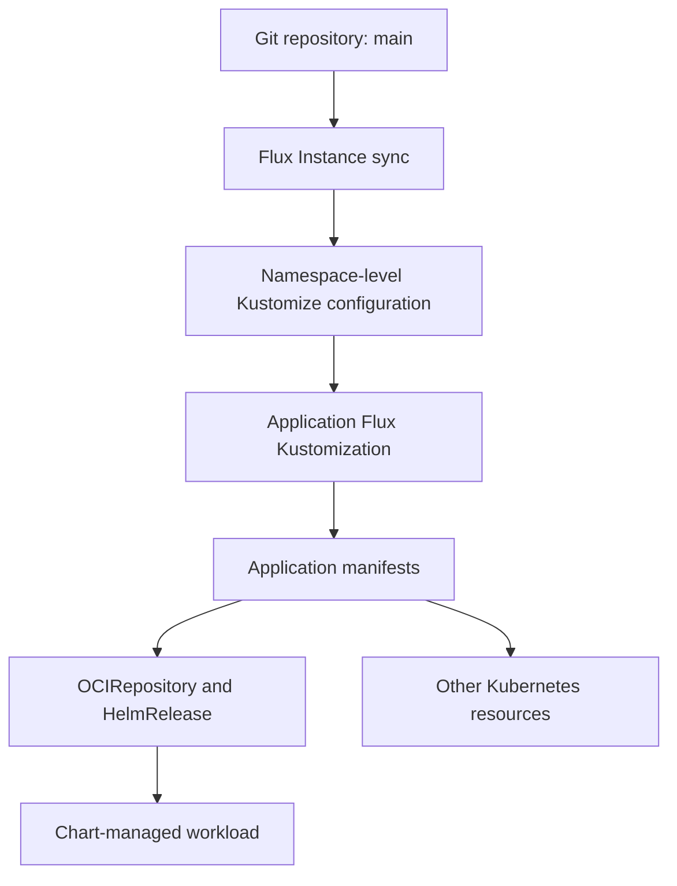

# GitOps

## Reconciliation chain

The Flux Instance is configured in `kubernetes/apps/flux-system/flux-instance/app/helmrelease.yaml`.
Its sync configuration selects `refs/heads/main` and the path `kubernetes/apps`.

A namespace's `kustomization.yaml` includes application `ks.yaml` files.
Each Flux Kustomization selects a source path and a target namespace, then reconciles resources from that path.
Application HelmReleases normally reference a nearby `OCIRepository` through `spec.chartRef`.

## Namespace placement

Application Flux Kustomizations and HelmReleases intentionally omit `metadata.namespace`.
The namespace-level Kustomize configuration sets the namespace on Flux Kustomizations, and each Flux Kustomization sets `spec.targetNamespace` for its resources.
Check that chain before adding a namespace field.

## Dependencies and health

Dependencies are explicit where required. For example, `rook-ceph-cluster` in
`kubernetes/apps/rook-ceph/rook-ceph/ks.yaml` depends on both `ceph-csi-drivers` and `rook-ceph`.
It checks the cluster HelmRelease and CephCluster, with expressions for Ceph health.

A successful manifest build alone does not establish that these runtime checks will pass.
Review dependency and health-check changes together with the resources they protect.

## Updates

Renovate proposes dependency changes through pull requests. Repository workflows perform checks;
merging changes into `main` makes them available to Flux.
A dependency update still needs upstream release evidence and review of its rendered impact.

Several application Kustomizations enable pruning. Removing or renaming resources can therefore remove live objects after reconciliation.
Storage, backup policies, and resource ownership need particular care.

## Source map

| Concern                                       | Location                                                         |
| :-------------------------------------------- | :--------------------------------------------------------------- |
| Sync branch and path                          | `kubernetes/apps/flux-system/flux-instance/app/helmrelease.yaml` |
| Application membership                        | `kubernetes/apps/<namespace>/kustomization.yaml`                 |
| Target path, namespace, dependencies, pruning | `kubernetes/apps/<namespace>/<app>/ks.yaml`                      |
| Chart source and values                       | Application `ocirepository.yaml` and `helmrelease.yaml` files    |
| Checks                                        | `.github/workflows/`                                             |

See the [repository workflow](../operations/workflow.md) for local validation.
