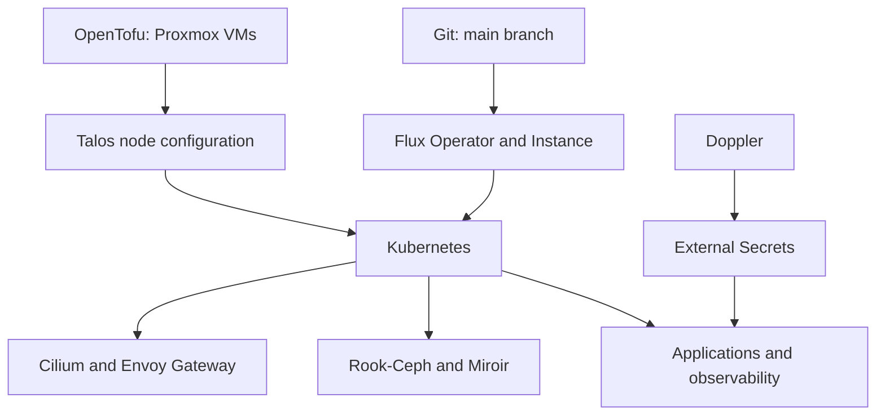

# Architecture

The cluster configuration is organized into infrastructure, node configuration, and applications.
The repository declares desired state; live health and hardware inventory require separate checks.

## Infrastructure and nodes

`infrastructure/opentofu/vm/` contains the Proxmox VM configuration.
`talos/` contains shared cluster settings, control-plane and worker templates, and per-node overrides under `talos/nodes/`.
The checked-in node overrides name three control-plane nodes and three workers; this is configuration inventory rather than a live node count.

Version declarations live in `talos/talenv.yaml`. Upgrade resources live under `kubernetes/apps/system-upgrade/tuppr/upgrades/`.
Check both when planning an upgrade, including the target Talos release's Kubernetes support matrix.

## Platform services

| Layer                                | Configuration location, relative to the repository root                                       |
| :----------------------------------- | :-------------------------------------------------------------------------------------------- |
| Cilium networking                    | `kubernetes/apps/kube-system/cilium/`                                                         |
| Gateway routing and certificates     | `kubernetes/apps/networking/envoy-gateway/`                                                   |
| Cloudflare connectivity and DNS      | `kubernetes/apps/networking/cloudflare-tunnel/`, `kubernetes/apps/networking/cloudflare-dns/` |
| Internal DNS gateway                 | `kubernetes/apps/networking/k8s-gateway/`                                                     |
| Certificate management               | `kubernetes/apps/cert-manager/`                                                               |
| Secret synchronization               | `kubernetes/apps/external-secrets/`                                                           |
| Flux controllers and synchronization | `kubernetes/apps/flux-system/`                                                                |
| Storage                              | `kubernetes/apps/rook-ceph/`, `kubernetes/apps/miroir-system/`                                |
| Monitoring                           | `kubernetes/apps/monitoring/`                                                                 |

The External Secrets `ClusterSecretStore` is named `doppler`. Application secrets refer to this provider rather than embedding credentials in Helm values.
Bootstrap credentials are a separate prerequisite, managed through the bootstrap configuration.

## Further reading

- [GitOps](gitops.md) explains the reconciliation chain and namespace conventions.
- [Network diagram](../network-diagram.md) shows the documented home topology.
- [Storage and backups](storage.md) describes data services and recovery considerations.
- [Repository workflow](../operations/workflow.md) explains how to prepare and check changes.
