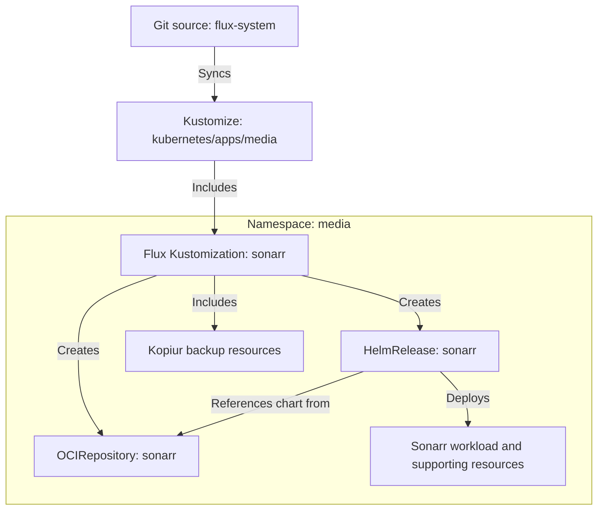
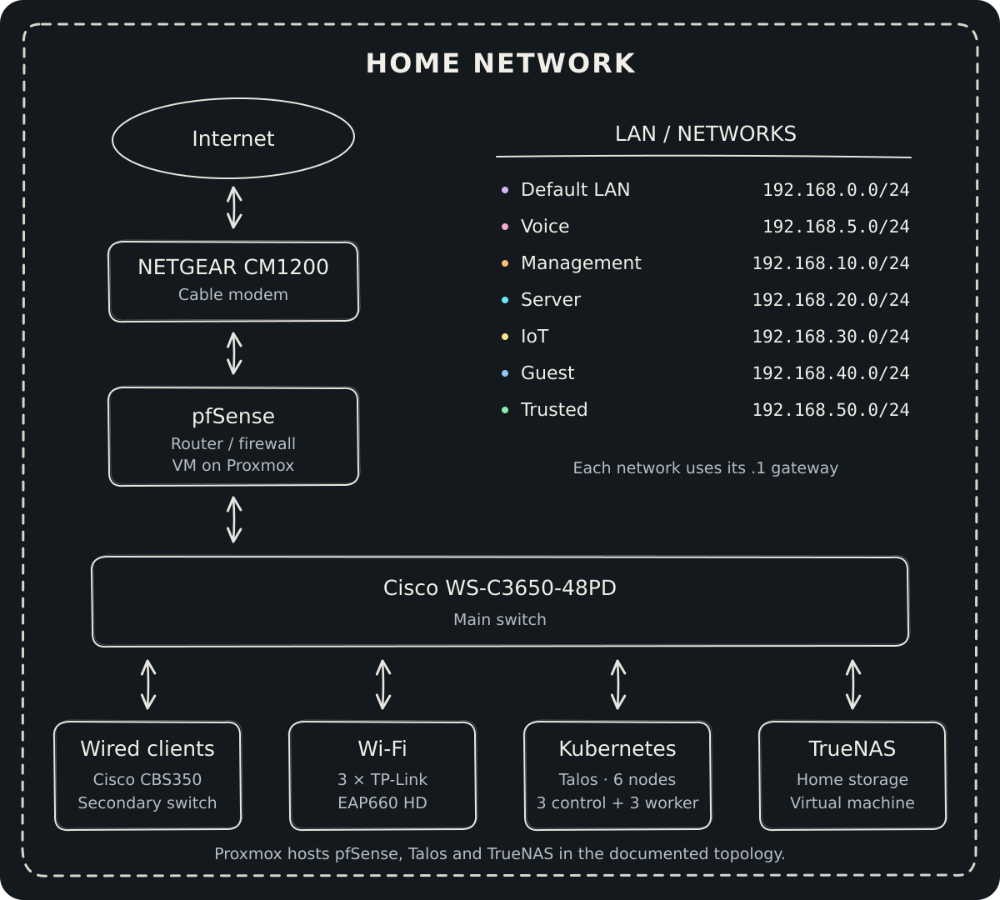

<!-- markdownlint-disable MD041 -->
<!-- markdownlint-disable MD033 -->

<div align="center">


### 🚀 My Home Operations Repository 🏠

_... managed with Flux, Renovate, and GitHub Actions_ 🤖

[Documentation](docs/src/index.md) · [Network diagram](docs/src/network-diagram.md) · [Issues](https://github.com/snoopy82481/home-cluster/issues)

</div>

<div align="center">

&nbsp;&nbsp;
&nbsp;&nbsp;
&nbsp;&nbsp;


</div>

<div align="center">

&nbsp;&nbsp;
&nbsp;&nbsp;
&nbsp;&nbsp;
&nbsp;&nbsp;
&nbsp;&nbsp;
&nbsp;&nbsp;


</div>

---

## 💡 Overview

Welcome to my home infrastructure repository. This is where I keep the configuration for my Kubernetes cluster and the services I run at home.
It is a home lab, a learning project, and infrastructure my family uses.

I manage it through Infrastructure as Code and GitOps: OpenTofu defines Proxmox VMs, Talos configuration defines the Kubernetes nodes,
and Flux keeps applications aligned with Git. Renovate and GitHub Actions help keep the configuration up to date and checked before changes land.

---

## 🌱 Kubernetes

The cluster runs Talos Linux, with configuration for three control-plane nodes and three workers.
Node templates and overrides live in [`talos/`](talos/), while [`infrastructure/`](infrastructure/) holds the Proxmox VM provisioning configuration.
Applications and storage services are managed together under [`kubernetes/apps/`](kubernetes/apps/).

### Core Components

- **Networking and ingress:** [Cilium](https://cilium.io/) handles cluster networking.
  [Envoy Gateway](https://gateway.envoyproxy.io/) provides internal and external gateways, with
  [Cloudflare Tunnel](https://developers.cloudflare.com/cloudflare-one/networks/connectors/cloudflare-tunnel/) connecting public traffic to the external gateway.
- **DNS:** [external-dns](https://github.com/kubernetes-sigs/external-dns) manages public Cloudflare records, while [k8s-gateway](https://github.com/k8s-gateway/k8s_gateway) provides DNS answers from Kubernetes resources.
- **Certificates and secrets:** [cert-manager](https://cert-manager.io/) manages certificates. [External Secrets](https://external-secrets.io/) retrieves application secrets from Doppler.
- **Storage and data protection:** [Rook-Ceph](https://rook.io/) and [Miroir](https://github.com/home-operations/miroir) provide storage.
  [Kopiur](https://github.com/home-operations/kopiur) and its shared components define application backup and restore resources.
- **Monitoring:** [Prometheus](https://prometheus.io/), [Grafana Operator](https://grafana.github.io/grafana-operator/), and
  [VictoriaLogs](https://docs.victoriametrics.com/victorialogs/) cover metrics, dashboards, and logs.
  [Gatus](https://gatus.io/) checks endpoints, and [Kromgo](https://github.com/home-operations/kromgo) supplies the badges above.
- **Automation:** [Flux Operator](https://fluxoperator.dev/) manages Flux, [tuppr](https://tuppr.home-operations.com) defines Talos and Kubernetes upgrades, and
  [Actions Runner Controller](https://docs.github.com/en/actions/concepts/runners/actions-runner-controller) manages self-hosted runners.
  [Spegel](https://spegel.dev/) provides a cluster-local image mirror.

### GitOps

The [Flux Instance](kubernetes/apps/flux-system/flux-instance/app/helmrelease.yaml) tracks `main` and reconciles the `kubernetes/apps` path.
Within each namespace directory, a `kustomization.yaml` includes the application's Flux Kustomizations in `ks.yaml` files.
Those select the application manifests, target namespace, and any dependencies or health checks.

Most chart-based applications pair a `HelmRelease` with an `OCIRepository` that supplies the chart.
Shared Kustomize components provide reusable configuration for backups, alerts, and scaling.

Renovate opens pull requests for dependency updates. Once a change is reviewed and merged, Flux picks up the new desired state and reconciles it into the cluster.

### Directories

```text
📁 kubernetes
├── 📁 apps           # Applications organized by namespace
└── 📁 components     # Reusable Kustomize components

📁 talos              # Node templates, overrides, and version declarations
📁 bootstrap          # Initial cluster bootstrap configuration
📁 infrastructure     # Proxmox VM provisioning with OpenTofu
📁 docs               # Documentation source and assets
```

### Flux Workflow

Sonarr provides an example of how Flux deploys an application into the `media` namespace.
The [namespace configuration](kubernetes/apps/media/kustomization.yaml) includes Sonarr's [Flux Kustomization](kubernetes/apps/media/sonarr/ks.yaml),
which reconciles the application manifests and adds the shared Kopiur backup component.
The [HelmRelease](kubernetes/apps/media/sonarr/app/helmrelease.yaml) references Sonarr's [OCIRepository](kubernetes/apps/media/sonarr/app/ocirepository.yaml) for the app-template chart.



### Networking

<details open>
<summary>Home network overview</summary>



The [detailed network diagram](docs/src/network-diagram.md) includes individual devices and connections.
This overview summarizes the documented topology; links do not represent individual cables or firewall rules.

</details>

---

## ☁️ Cloud Dependencies

Some parts of the setup depend on services outside the house. GitHub holds the configuration and runs repository automation,
Cloudflare handles public DNS and tunnel connectivity, and Doppler holds the secrets consumed by the cluster.

| Service                                   | Use                                                                      | Cost             |
| :---------------------------------------- | :----------------------------------------------------------------------- | :--------------- |
| [GitHub](https://github.com/)             | Git repository, pull requests, dependency updates, and Actions workflows | Free             |
| [Cloudflare](https://www.cloudflare.com/) | Public DNS and tunnel access to externally exposed services              | ~$20/yr          |
| [Doppler](https://www.doppler.com)        | Secret storage for External Secrets and environment-specific tooling     | Free             |
| [Proton VPN](https://www.protonvpn.com)   | VPN client                                                               | ~$85/yr          |
|                                           |                                                                          | Total: ~$8.75/mo |

---

## 🌎 DNS

DNS uses a split configuration so applications can be reached by name both from home and through their public endpoints.

**Inside the home network**, clients using pfSense for DNS have queries for the application domain forwarded to
[`k8s-gateway`](kubernetes/apps/networking/k8s-gateway/app/helmrelease.yaml) through a
[DNS Resolver domain override](https://docs.netgate.com/pfsense/en/latest/services/dns/resolver-domain-overrides.html).
k8s-gateway watches Kubernetes Services and HTTPRoutes and answers those queries using the cluster's advertised addresses.
This lets local clients reach applications directly over the home network without sending their traffic through Cloudflare.
pfSense continues to resolve other domains normally.

**For public access**, [`cloudflare-dns`](kubernetes/apps/networking/cloudflare-dns/app/helmrelease.yaml) runs ExternalDNS with the Cloudflare provider.
It maintains public records from HTTPRoutes attached to the external Envoy gateway and from DNSEndpoint resources.
Cloudflare Tunnel carries incoming application traffic to that gateway, where Envoy routes it to the appropriate service.

DNS determines where a hostname points; the separate internal and external Envoy gateways control how application traffic is routed.

---

## ⚙️ Hardware

The inventory below follows the existing [network diagram](docs/src/network-diagram.md) and checked-in node configuration.

### Compute and Storage

| Component                          | Role                                           |
| :--------------------------------- | :--------------------------------------------- |
| Dell PowerEdge R520 / Proxmox      | Virtualization host in the documented topology |
| `kmaster1`, `kmaster2`, `kmaster3` | Talos control-plane node configurations        |
| `kworker1`, `kworker2`, `kworker3` | Talos worker node configurations               |
| TrueNAS                            | Storage system in the documented topology      |

### Networking Stack

| Device                   | Role                            |
| :----------------------- | :------------------------------ |
| NETGEAR Nighthawk CM1200 | Cable modem                     |
| pfSense                  | Virtualized firewall and router |
| Cisco WS-C3650-48PD      | Main switch                     |
| Cisco CBS350             | Secondary switch                |
| TP-Link EAP660 HD V1     | Wireless access points          |
| Omada Controller         | Wireless management             |

---

## 📖 Documentation

The [documentation](docs/src/index.md) expands on the architecture and repository workflows.
Its longer-term purpose is to give my wife a practical reference for the home setup if I am no longer around to maintain it.
The current pages are a starting point; the household instructions and recovery procedures still need to be developed.

---

## 🙏 Gratitude and Thanks

The structure of this README is inspired by [onedr0p/home-ops](https://github.com/onedr0p/home-ops/).
Thanks to the Home Operations community for sharing configurations, tools, and lessons that make running a home cluster more approachable.

## License

See [LICENSE](LICENSE) for the WTFPL terms included in this repository.
